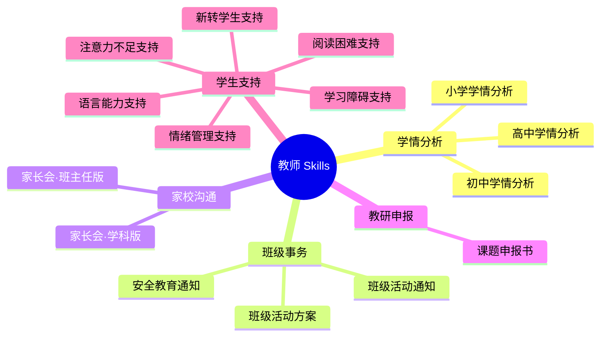
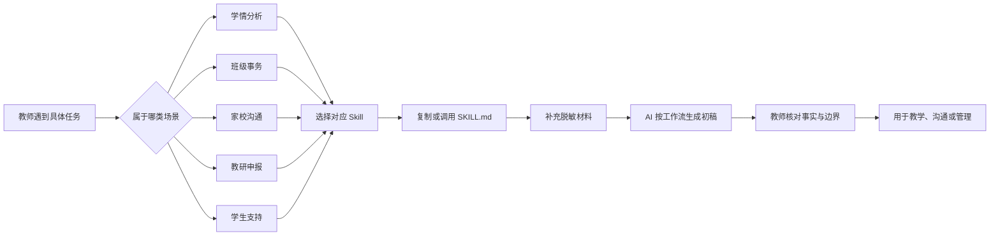
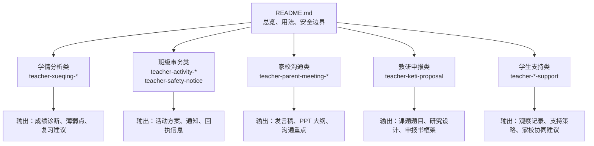

# 教师 Skills · 15 个开箱即用的教师 AI 技能

> **一句话摘要**：这是 15 个写给 AI 助手的"工作说明书"。你不用学提示词，不用调参数——直接跟 AI 说话，它就按一线教师的真实工作流帮你干活：分析成绩、写通知、准备家长会、打磨课题申报书、给有需要的学生做支持计划。

## 它能帮你干什么

| 场景 | 对应的 Skill |
|---|---|
| 考完试，想知道班级哪里弱 | 小学 / 初中 / 高中学情分析 |
| 班会、研学、出游，要方案和通知 | 班级活动方案、班级活动通知 |
| 假期或专项安全，要发通知 | 安全教育通知 |
| 开家长会，要发言稿和 PPT 大纲 | 家长会·班主任版 / 学科版 |
| 申报课题，没思路 | 课题申报书 |
| 班里有孩子需要特别支持 | 注意力 / 情绪 / 语言 / 学习障碍 / 转学生 / 阅读困难支持 |

## 一图看懂

### 技能地图



### 使用流程



### 文件关系



## 使用方法

### 第一步：挑一个 Skill
看上面的表，找到你要办的那件事。

### 第二步：跟 AI 说一句话
照下面"一句话用法"说，AI 会接着问你要材料，你给它就行。

### 第三步：材料记得脱敏，结果你把关
成绩、学生信息用学号或化名，别出现真实姓名。AI 出的东西，最后你自己核对一遍再用。

## 15 个 Skill 一句话用法

| # | Skill | 你跟 AI 说 | 你要准备的材料 |
|---|---|---|---|
| 01 | 小学学情分析 | "用小学学情分析帮我看下这次成绩" | 脱敏成绩表、试卷结构 |
| 02 | 初中学情分析 | "按模块分析下这次考试" | 模块划分、成绩 |
| 03 | 高中学情分析 | "诊断下这次考试，复习重点怎么排" | 考试范围、成绩、剩余备考时间 |
| 04 | 班级活动方案 | "帮我做个班会 / 研学方案" | 时间地点人数、活动目标 |
| 05 | 班级活动通知 | "写个活动通知发家校群" | 时间地点费用、回执要求 |
| 06 | 安全教育通知 | "写个假期安全通知" | 假期时段、风险主题 |
| 07 | 家长会·班主任版 | "家长会发言稿帮我写一下" | 班级情况、会议主题 |
| 08 | 家长会·学科版 | "家长会上学科部分讲什么" | 学科、学情要点 |
| 09 | 课题申报书 | "帮我打磨课题申报书" | 申报级别、研究想法 |
| 10 | 注意力不足支持 | "有个学生注意力不集中怎么办" | 具体行为观察（不要标签） |
| 11 | 情绪管理支持 | "学生情绪失控怎么应对" | 触发场景、行为表现 |
| 12 | 语言能力支持 | "他总听不懂要求怎么办" | 具体困难点 |
| 13 | 学习障碍支持 | "各科都跟不上，做个辅导方案" | 各科表现、已试过的方法 |
| 14 | 新转学生支持 | "班里来了转学生，做个适应计划" | 原学校进度、首周观察 |
| 15 | 阅读困难支持 | "读书慢、读不懂，做个支持方案" | 具体表现（速度/理解/朗读） |

每个 Skill 文件夹里的 `SKILL.md` 就是完整工作流：什么时候用、问你要什么、按什么步骤做、交出什么样的东西。AI 照着走就行。

## 三条红线，请认真看

1. **数据先脱敏**：成绩、学生信息一律用学号或化名，不出现真实姓名。
2. **结果你把关**：AI 给的是建议稿，数字、名单、责任人一定自己核对一遍再用。
3. **学生支持不代替专业诊断**：10–15 号 Skill 只做教育支持，不下诊断结论；拿不准就转介校心理老师或专业机构。

## 目录结构

```
teacher-skills/
├── README.md
├── teacher-xueqing-primary/              # 01 小学学情分析
├── teacher-xueqing-middle/              # 02 初中学情分析
├── teacher-xueqing-high/                # 03 高中学情分析
├── teacher-activity-plan/               # 04 班级活动方案
├── teacher-activity-notice/             # 05 班级活动通知
├── teacher-safety-notice/               # 06 安全教育通知
├── teacher-parent-meeting-homeroom/     # 07 家长会·班主任版
├── teacher-parent-meeting-subject/      # 08 家长会·学科版
├── teacher-keti-proposal/               # 09 课题申报书
├── teacher-attention-support/           # 10 注意力不足支持
├── teacher-emotion-support/             # 11 情绪管理支持
├── teacher-language-support/            # 12 语言能力支持
├── teacher-learning-disability-support/ # 13 学习障碍支持
├── teacher-transfer-support/            # 14 新转学生支持
└── teacher-reading-support/             # 15 阅读困难支持
```

## 常见问题

**Q：一定要装到 WorkBuddy 里才能用吗？**
A：不用。每个 `SKILL.md` 都是一份中文工作流，任何 AI 助手（WorkBuddy、Muse、DeepSeek……）照着做都行。你直接把文件内容贴给 AI，说"按这个 skill 来"，它就懂了。

**Q：学生支持类 Skill 会不会乱下诊断？**
A：不会。6 个学生支持 Skill 都写死了边界：只做教育支持、不下诊断结论，情绪支持还有危机转介条款。真拿不准的，转介专业机构。

**Q：成绩数据怎么脱敏？**
A：把姓名换成学号或"学生A / B / C"，截图前打码。AI 不需要知道孩子是谁。

**Q：我想改某个 Skill，改哪里？**
A：直接改对应文件夹里的 `SKILL.md`，改完就能用，不用重新"安装"。
